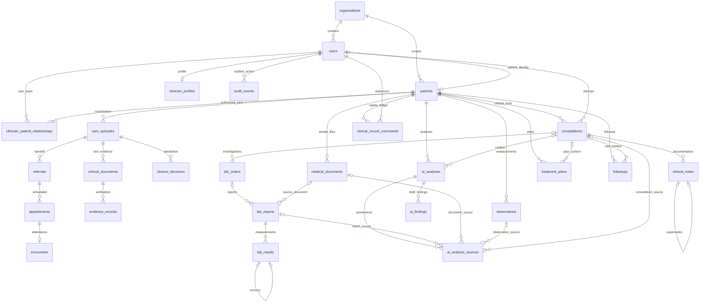

# Entity relationships

This diagram shows implemented patient-care relationships. Auxiliary policy, messaging, integration and evaluation tables are listed in the [dictionary](schema.md). The two document/encounter families intentionally serve different workflows.

`users.clerk_user_id` is the unique external identity link. The Clerk directory is external; medical data stays in PostgreSQL/private object storage. New longitudinal links use composite foreign keys to enforce organization and patient agreement. The legacy `users.patient_id` association remains application-managed; this migration does not add a foreign key or uniqueness constraint to that existing column. No diagram edge implies cascade deletion or automatic clinical authorization.
