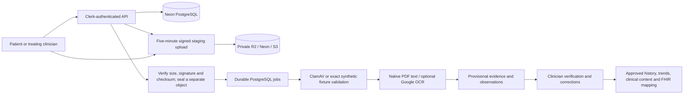

# Medical document management

CareLoop extends the existing patient clinical-record workspace with private, versioned documents. It uses existing Clerk identities, care relationships, consent checks, Neon PostgreSQL, and `audit_events`. No second patient/user directory or public file store is created.

## Architecture and lifecycle



1. Initialization authorizes the patient relationship and creates a five-minute upload session. Its opaque staging key is separate from the immutable version key. The browser uploads directly with the returned headers.
2. Completion verifies actual object size, declared MIME against file signatures, and SHA-256. If supplied, the client checksum must match. It writes the verified bytes to a separate final object, then atomically records the version and processing job. Reusing the staging URL cannot replace the sealed version. A stale session cannot replace a newer completed version.
3. The worker claims jobs using `FOR UPDATE SKIP LOCKED`, an expiring lease, and a fencing token. It rechecks current version, deletion, uploader account, and care authorization before publication. Crashed jobs can be reclaimed; retries are bounded and extraction insertion is idempotent.
4. The file remains unavailable for preview/download until security validation succeeds. Missing or unavailable ClamAV is **not** a clean scan. Infected files cannot be retried into a trusted state.
5. A resource-limited PDF.js worker extracts actual PDF text, page numbers, and locations. A conservative parser recognizes explicitly supported laboratory table layouts. Unsupported content is retained for manual review. Images/scans require configured OCR for text extraction.
6. Extraction, detected metadata, evidence quotes, and observations remain provisional. A clinician can correct a value with a reason, verify/reject an observation, and approve/reject/request corrections for the exact document version. Original source fields, extraction output, corrections and reviews remain retained.
7. Only verified observations from the approved, security-validated current version enter clinical context, FHIR clinical results, and trends. A subsequent correction or replacement invalidates current approval. No diagnostic or treatment decision is generated automatically.

UI stages are `uploading`, `security_checks`, `extracting`, `awaiting_review`, `reviewed`, `failed`, `unavailable`, `cancelled`, and `legacy`. Security state and clinical review state are separate from processing stage. Retry never bypasses security checks.

## Schema and migration

`packages/db/migrations/0007_document_management.sql` extends `medical_documents` and adds:

| Table | Purpose |
| --- | --- |
| `document_versions` | Immutable object references, SHA-256, MIME, size and version lineage |
| `document_upload_sessions` | Expiring upload authorization and staging/final object references |
| `document_processing_jobs` | Durable queue, leases, retries and sanitized failures |
| `document_security_checks` | Immutable verdict for an exact version/checksum |
| `document_extractions` | Immutable extraction output and provider/model provenance |
| `clinical_observations` | Provisional or verified measurements with original source evidence |
| `document_observation_corrections` | Before/after correction history and reason |
| `clinical_document_reviews` | Reviewer, decision, notes and exact version |
| `document_timeline_events` | Durable document lifecycle events |

Composite foreign keys bind organization, patient, document and version. Database triggers protect immutable evidence and source fields. PostgreSQL full-text search indexes metadata and extracted text; query authorization is applied before results or counts are returned. No vector extension is required.

Existing document objects and IDs are retained as `legacy`; migration does not fabricate scan results or clinical approval. The old base64 HTTP upload endpoint returns `410 MANAGED_UPLOAD_REQUIRED`. Older read projections exclude removed or unsafe managed files. New previews require explicit version security evidence.

Use the existing migration command with the selected direct owner connection after testing. Remote API/worker startup refuses pending migrations; it does not seed or migrate a shared database automatically.

```sh
npm run db:migrate
npm run db:grant-documents           # dry run; existing restricted runtime role
npm run db:grant-documents -- --apply
```

The grant update adds reviewed SELECT/INSERT rights on nine new tables and UPDATE rights on four mutable tables. It grants no DELETE, schema creation, or future-table permissions and changes no credentials. `db:provision-runtime` includes these grants for a newly provisioned role.

## Storage and configuration

All credentials are server-only and belong in ignored local environment files or deployment secrets. Never place them in `NEXT_PUBLIC_*`, logs, links shared with others, or source control. Storage must have public access disabled; the application requires `DOCUMENT_STORAGE_PRIVATE=true` as an explicit operator assertion.

| Setting | Meaning |
| --- | --- |
| `DOCUMENT_STORAGE_PROVIDER` | `r2`, `neon` or `s3` for new uploads |
| `DOCUMENT_STORAGE_PRIVATE` | Must be `true` |
| `DOCUMENT_MAX_BYTES` | Default and maximum 15 MiB; may be lowered |
| `DOCUMENT_RESTORE_DAYS` | Restoration window, default 30 days |
| `R2_ACCOUNT_ID`, `R2_ENDPOINT`, `R2_BUCKET_NAME` | Account-specific HTTPS R2 S3 endpoint and private bucket |
| `R2_ACCESS_KEY_ID`, `R2_SECRET_ACCESS_KEY` | Bucket-scoped R2 object credentials |
| `AWS_ENDPOINT_URL_S3`, `AWS_REGION`, `AWS_ACCESS_KEY_ID`, `AWS_SECRET_ACCESS_KEY` | Existing Neon CLI-managed storage tuple |
| `DOCUMENT_STORAGE_BUCKET` | Neon/S3 bucket; Neon default `careloop-medical-documents` |
| `DOCUMENT_STORAGE_REGION`, `DOCUMENT_STORAGE_ENDPOINT`, `DOCUMENT_STORAGE_ACCESS_KEY_ID`, `DOCUMENT_STORAGE_SECRET_ACCESS_KEY` | Explicit generic S3 tuple |
| `CLAMAV_SOCKET` or `CLAMAV_HOST` / `CLAMAV_PORT` | Local ClamD Unix socket or loopback INSTREAM listener; default port 3310 |
| `DOCUMENT_SYNTHETIC_FIXTURES` | Exact committed fixture hash allowlist, only when `true`, `DEMO_MODE=true`, and environment is development/test |
| `DOCUMENT_EXTERNAL_PROCESSING_ALLOWED` | Explicit opt-in required for sending source content to OCR/model providers |
| `GOOGLE_CLOUD_PROJECT_ID`, `GOOGLE_CLOUD_LOCATION`, `GOOGLE_DOCUMENT_AI_PROCESSOR_ID` | Existing Google Document AI processor; uses Application Default Credentials |
| `MEDGEMMA_ENDPOINT`, `MEDGEMMA_MODEL`, `MEDGEMMA_API_KEY` | Authorized HTTPS OpenAI-compatible chat-completions endpoint, explicit model and key |

Each provider must have its own complete tuple. Keys are never borrowed across providers and ambient AWS profiles are not used. Selecting R2 for new uploads does not rewrite existing Neon references; retain the original storage credentials to read them. The current prototype supports PDF, JPEG and PNG. WebP is intentionally not enabled.

An R2 bucket needs browser CORS for direct uploads and PDF/image retrieval. Replace the example origins with exact deployed origins; do not use a public bucket or wildcard credential policy:

```json
[
  {
    "AllowedOrigins": ["http://localhost:3001", "https://YOUR_APP_HOST"],
    "AllowedMethods": ["GET", "PUT", "HEAD"],
    "AllowedHeaders": ["Content-Type", "Range", "If-Range"],
    "ExposeHeaders": ["ETag", "Content-Length", "Content-Range", "Accept-Ranges"],
    "MaxAgeSeconds": 300
  }
]
```

PUT URLs bind content type and declared content length and expire after five minutes; completion also verifies the actual byte count. GET URLs expire within 60 seconds and specify private/no-store responses. A signed URL already issued remains usable until expiry. Configure a storage lifecycle rule to expire abandoned `document-uploads/` staging objects after one day; never apply this rule to `medical-documents/` originals. Soft deletion retains originals and audit records; no automatic destructive retention purge is implemented.

See the official [R2 presigned URL](https://developers.cloudflare.com/r2/api/s3/presigned-urls/) and [CORS](https://developers.cloudflare.com/r2/buckets/cors/) documentation for bucket-side configuration.

## API contract

Paths use the existing app origin and Clerk session authentication. Let `P=/api/patients/:patientId/documents`. Every mutation requires `Idempotency-Key` and JSON. Presigned PUT requests use the returned URL and headers directly, without a Clerk token.

| Method | Path | Purpose |
| --- | --- | --- |
| GET | `P/manage` | List/search/filter/counts; `q,type,status,reviewStatus,from,to,sort,limit,offset,deleted` |
| GET | `P/review-queue` | Treating-clinician review queue |
| POST | `P/upload/init` | Metadata, filename, MIME, size, optional SHA-256; returns session and signed PUT |
| POST | `P/upload/complete` | `{sessionId}`; validate/seal version and queue processing |
| POST | `P/upload/cancel` | `{sessionId}`; cancel an unfinished upload |
| GET | `P/:documentId/detail` | Metadata, versions, extraction, observations, jobs, reviews and capabilities |
| GET | `P/:documentId/preview` | Short signed preview URL; optional `versionId` |
| GET | `P/:documentId/download-managed` | Short attachment URL; optional `versionId` |
| PATCH | `P/:documentId` | Replace editable metadata |
| DELETE | `P/:documentId` | `{reason}`; retain record and remove from active views |
| POST | `P/:documentId/restore` | Restore within configured window |
| POST | `P/:documentId/retry` or `/process` | Retry failed/cancelled processing without bypassing checks |
| POST | `P/:documentId/request-review` | Ask for clinical review |
| PATCH | `P/:documentId/observations/:observationId` | Correct supported fields / verify; requires `reason` |
| POST | `P/:documentId/review` | `{versionId,status,reviewNotes}` |
| GET | `P/observations` | Approved verified current measurements |
| GET | `P/timeline` | Authorized document events |
| GET | `P/trends` | Compatible verified measurement series |
| GET | `P/:documentId/fhir` | R4 mapping bundle; no external transmission |

`packages/contracts/src/documents.ts` is the executable request/response contract. Metadata includes title, description, document type, tags, document date, provider name and optional existing encounter ID. For a replacement upload, initialization also requires `documentId` and `changeReason`. Responses never expose secret credentials or persistent storage keys.

Patient access is limited to their own records and the established release rules. Approved treating clinicians require an active authorized care relationship and consent. Administrative role alone provides no patient-record access. Patients cannot verify measurements or approve clinical documents. All file access rechecks current authorization before issuing a URL. Record removal, version changes, and revoked authorization prevent in-flight jobs from publishing stale results.

## Extraction, review and interoperability

The native parser is deliberately conservative: it does not claim universal laboratory recognition. It preserves original values/units/ranges and exact page evidence; uncertain values receive warnings or remain text. No inferred LOINC, UCUM conversion, fabricated normal ranges, diagnostic claims, or drug advice is inserted.

Google OCR uses the configured processor via ADC. MedGemma receives source text only after explicit external-processing opt-in. Documents are untrusted input: the model has no tools, requests structured extraction only, and returned fields must be anchored in exact source lines. Invalid or unavailable model output never becomes approved data. With a configured model, summary quotes must match complete source lines on valid pages; they are labeled AI-generated and provisional until review. Without a valid model summary, the UI shows explicitly labeled source quotes and an unavailable warning. Neither path creates a diagnosis or claims AI inference occurred when no model ran.

Trends require numeric verified observations, recorded dates, and matching test name, unit, method and specimen context. Missing comparison context excludes a result from trends; there is no silent conversion or interpolation. Corrected source values remain visible in the audit history.

`packages/fhir/src/documents.ts` maps DocumentReference, Observation and DiagnosticReport and provides Patient, Practitioner and Encounter mapping functions. It preserves local IDs, exact-decimal provenance, source page and document-version references. Clinical observations are exported only after approval. This is an R4 mapping boundary, not a conformant external FHIR server, SMART integration, terminology service, or completed EHR exchange. Attachment bytes and temporary URLs are not embedded in mapping output. The authenticated-retrieval-endpoint extension identifies the CareLoop JSON endpoint that authorizes and returns a short download URL; it is not an unauthenticated FHIR Binary URL. Reference: [FHIR R4 DocumentReference](https://hl7.org/fhir/R4/documentreference.html), [Observation](https://hl7.org/fhir/R4/observation.html), [DiagnosticReport](https://hl7.org/fhir/R4/diagnosticreport.html).

## Verification and demonstration

Synthetic originals are in `tests/fixtures/medical-documents/`: HbA1c and follow-up, CBC, lipids, metabolic panel, consultation, prescription, ambiguous report and raster scan. They contain no real patient information. The committed SHA-256 fixture set is the only synthetic scanner allowlist; naming an arbitrary upload “synthetic” grants nothing.

```sh
pnpm test
pnpm typecheck
pnpm lint
npm run build
pnpm dev
```

Database tests use randomly named local schemas, never the configured Neon production database. They exercise sealing, replay, IDOR, relationship revocation, checksums/MIME/size, immutable evidence, concurrent processing, missing scanners/OCR, manual review, clinical-context filtering and deletion. Browser component verification uses synthetic API fixtures; distinguish it from a live Clerk-authenticated journey.

For a local development demonstration, configure private storage and CORS, enable the exact synthetic fixture allowlist in a development environment, and run API/web/worker. Sign in as a patient, open Clinical records → Medical documents, upload a committed PDF, wait for processing, inspect provisional source-linked extraction, then sign in as the approved treating clinician to verify/reject values and approve the exact version. Upload the follow-up fixture and compare verified compatible observations. Upload a non-allowlisted document without a scanner to demonstrate quarantine.

R2, ClamAV, Google OCR and MedGemma need actual configured services for live verification. Adapter code, signed-URL unit tests and synthetic extraction tests do not establish that an unconfigured external service works. The implementation does not provision these services, alter Clerk accounts, or enable external content transmission by default.


The guarded live development probe uses existing synthetic application identities, never new Clerk users:

```sh
DOCUMENT_VERIFY_BROWSER=true DATABASE_ENVIRONMENT=development \
  node --env-file=.env.neon-development --import tsx scripts/verify-document-development.ts
```

It requires the designated development database/storage branch and applied migration 0007, performs real API/Neon calls and browser signed PUT/GET requests, and retains one synthetic document per run. Identity verification and malware scanning use explicitly declared fixture mechanisms; this command does not prove live Clerk login or live antivirus operation. Never point this probe at production.
